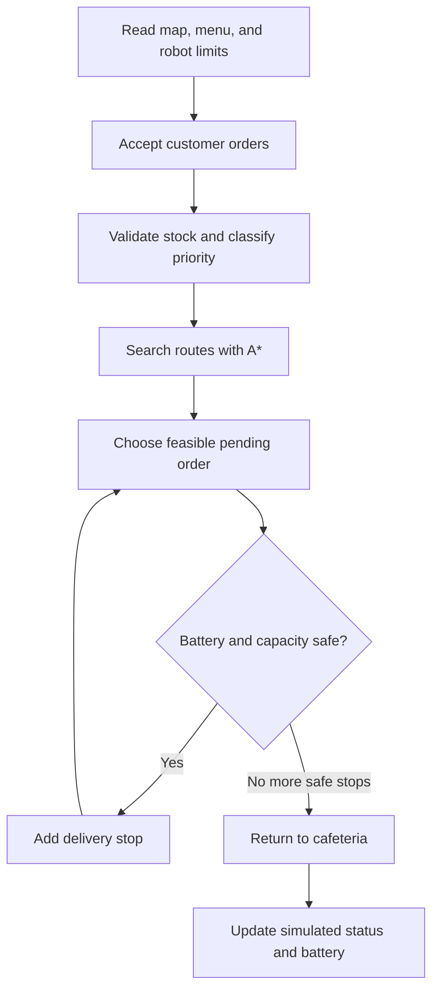

# Intelligent Food Delivery Agent

**Artificial Intelligence Course Project**  
**Group size:** Four members  
**Group members:** Member 1: ____________________ · Member 2: ____________________ · Member 3: ____________________ · Member 4: ____________________  
**Institution:** ____________________  
**Course instructor:** ____________________  
**Submission date:** ____________________

## Abstract

This project models an intelligent agent that carries cafeteria food to students or departments on a campus. The agent accepts orders, checks food stock, classifies order priority, searches a campus graph, and selects a feasible sequence of deliveries. BFS and DFS demonstrate graph traversal, while A* finds a least-time route. A priority-based scheduler checks estimated delivery deadlines, robot carrying capacity, and the battery needed for the full trip back to the cafeteria. The project includes a browser dashboard and an offline Python terminal simulation. Both use sample data and demonstrate core AI ideas without controlling a physical robot.

## 1. Problem statement

Campus cafeteria staff may receive orders for several buildings at once. Delivering them in an arbitrary order can waste time, delay sensitive food, overload a robot, or leave it without enough battery to return. The project represents the campus as a graph and builds an agent that uses search and simple planning rules to manage these decisions.

## 2. Objectives

1. Store campus locations, road connections, menu items, and stock.
2. Record customer orders and their delivery destinations.
3. Classify orders using requested urgency, deadline, and whether the food is perishable.
4. Demonstrate BFS and DFS on the campus graph.
5. Use A* to find a least-time path between locations.
6. Schedule multiple orders while respecting battery and carrying limits.
7. Explain the agent's decisions in a terminal demonstration.

## 3. Scope and assumptions

- The campus graph and road times are fixed sample data.
- Each road has a positive travel-time cost and can be traversed in either direction.
- Manhattan distance is an admissible A* heuristic for the supplied grid map because every road cost is at least the Manhattan distance between its endpoints.
- Order deadlines are minutes from the beginning of the simulated tour. Food handling time at a building is ignored.
- Battery use is modeled as a fixed percentage per travel minute.
- All orders begin at the cafeteria. The agent must have enough battery for the planned route and a return to the cafeteria.
- A delivered order is marked as simulated. No real robot, GPS, payment service, or database is connected.

## 4. Intelligent agent design

### PEAS description

| Element | Project description |
| --- | --- |
| Performance measure | Deliver higher-priority orders promptly, use short routes, avoid capacity violations, and keep enough battery for the return trip. |
| Environment | Sample campus graph, cafeteria menu and stock, customers, pending orders, and one delivery robot. |
| Actuators | Create a delivery plan, select the next order, print route steps, update simulated order status, and recharge at the cafeteria. |
| Sensors | User-entered orders, menu stock, map connections, deadlines, robot battery, and item weights. |

### Agent cycle

## 5. Knowledge and data representation

The campus is an undirected weighted graph. Each location is a node with `(x, y)` coordinates. Each road is an edge with a travel time in minutes. The menu stores each food item's name, price, weight, stock, and perishability. An order stores its customer, item quantities, destination, deadline, requested urgency, calculated priority, and status.

The configurable values are in `campus_config.json`. The provided campus and menu are examples and can be replaced with values approved by the instructor or group.

## 6. AI algorithms

### BFS and DFS

BFS uses a queue and visits nearby nodes before more distant graph layers. DFS uses a stack and follows a branch before backtracking. In this project, they are traversal demonstrations. Since road costs can differ, neither traversal is used to claim the least-time route.

### A* route search

A* evaluates nodes using:

`f(n) = g(n) + h(n)`

Here, `g(n)` is the travel time from the start to node `n`; `h(n)` is Manhattan distance from `n` to the goal. The map's edge times make this heuristic admissible, so A* can return a minimum-time path on the supplied map.

### Order priority

The priority score combines three small rules:

- Requested urgency: urgent = 3, normal = 1, low = 0 points.
- Deadline: at most 10 minutes = 2 points; at most 20 minutes = 1 point; later = 0 points.
- Perishable food: add 1 point if an order contains a perishable item.

Scores of 5 or more are High priority, scores of 3 or 4 are Medium, and lower scores are Low. The scheduler first favors the score, then an earlier deadline, then a shorter next route leg. A lateness penalty also lowers an order's ranking when its estimated arrival exceeds its deadline.

### Multiple-order planning and resource checks

The scheduler greedily chooses the best feasible pending order, updates its current location and estimated arrival time, and repeats. It adds an order only when:

`loaded weight + order weight <= robot carrying capacity`

and

`travel time already used + next leg + return-to-cafeteria time <= battery available / battery use per minute`.

This keeps a return route available after each proposed stop. It is a heuristic planner, so it is understandable for a course demonstration but does not guarantee the globally best possible tour for every campus or order set.

## 7. Program workflow

1. Load the map, menu, and robot limits. The Python terminal version reads `campus_config.json`; the browser dashboard has matching sample data in `index.html`.
2. Accept customer, item, urgency, deadline, and destination details.
3. Validate the order and reserve the requested stock.
4. Calculate its weight, total price, priority score, and priority level.
5. When the tour starts, run A* from the robot's current stop to each candidate destination and from that destination back to the cafeteria.
6. Rank feasible orders and add one stop at a time while the payload and battery limits allow it.
7. Simulate the selected route, mark its orders delivered, subtract battery use, and list unselected orders with a reason.

## 8. Sample demonstration calculation

This example uses the sample configuration and illustrates the calculation. Place three orders:

| Order | Destination | Food | Weight | Urgency | Deadline | Priority |
| --- | --- | --- | ---: | --- | ---: | --- |
| O001 | Library | 2 vegetable sandwiches | 0.80 kg | Urgent | 15 min | High, score 5 |
| O002 | Engineering Block | 1 vegetarian thali | 0.70 kg | Normal | 18 min | Medium, score 3 |
| O003 | Hostel | 3 packaged juices | 0.75 kg | Normal | 40 min | Low, score 1 |

The combined load is `0.80 + 0.70 + 0.75 = 2.25 kg`, which is within the sample robot capacity of 8 kg. A priority-first tour can visit Library, Engineering Block, then Hostel. With the configured roads, the route can take 1 + 1 + 2 + 4 = 8 minutes including the return to the cafeteria. At 3 battery percentage points per minute, the estimated use is 24 percentage points. The figures are sample values for explaining the model.

## 9. Four-member work division

| Member | Main responsibility | Modules and deliverables |
| --- | --- | --- |
| Member 1 | Customer orders and food data | Menu and stock records, order entry, destination selection, order validation, priority classification, and the project overview in the report. |
| Member 2 | Campus map and basic search | Cafeteria and campus locations, graph data, map display, BFS and DFS, and the map/search explanation in the report. |
| Member 3 | Route and robot resources | A* search, travel-time estimates, battery calculation, carrying-capacity checks, and the A*/resource explanation in the report. |
| Member 4 | Scheduling and integration | Multi-order scheduling, terminal interface integration, simulated delivery output, sample demonstration, final report assembly, and presentation coordination. |

Each member should explain their module during the presentation. Member 4 coordinates integration, while each other member provides a short description and example for their section. The group should enter its real names above and confirm that everyone understands the complete flow.

## 10. Files and setup

- `index.html`: browser dashboard, order form, BFS/DFS/A* search, and tour scheduler.
- `web_server.py`: local server that opens the browser dashboard.
- `agent.py`: Python data models, BFS, DFS, A*, priority classification, scheduler, resource checks, and terminal interface.
- `campus_config.json`: editable sample campus map, menu, stock, and robot settings.
- `README.md`: setup and demonstration instructions.
- `PRESENTATION_OUTLINE.md`: slide-by-slide speaking plan.

Run the browser version with `/usr/local/bin/python3 web_server.py` from the project folder on the provided Mac setup. Run the terminal version with `/usr/local/bin/python3 agent.py`. Python 3.9 or later is recommended. No external packages are required.

## 11. Limitations and future work

The prototype uses a fixed map and static travel times. It does not handle blocked paths, live traffic, simultaneous robots, changing battery condition, or physical movement. The greedy scheduler may miss a globally optimal route. Future work could add a graphical interface, live location updates, dynamic obstacle handling, persistent order storage, and comparison of greedy schedules with an exact optimizer on small examples.

## 12. Conclusion

The project combines intelligent-agent design, graph representation, BFS, DFS, A*, priority rules, and resource-aware planning in one campus delivery simulation. The group can demonstrate how an agent uses its map and order information to choose destinations while preserving a safe return to the cafeteria. The configuration file and four-role plan make the prototype straightforward to adapt and present.
